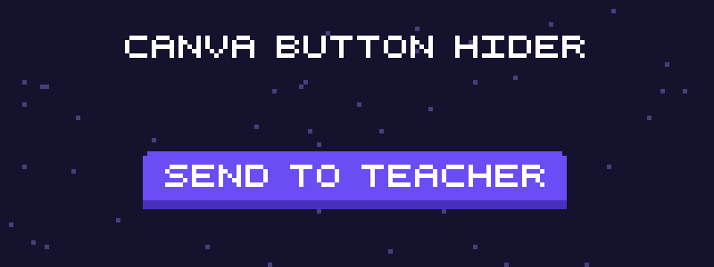
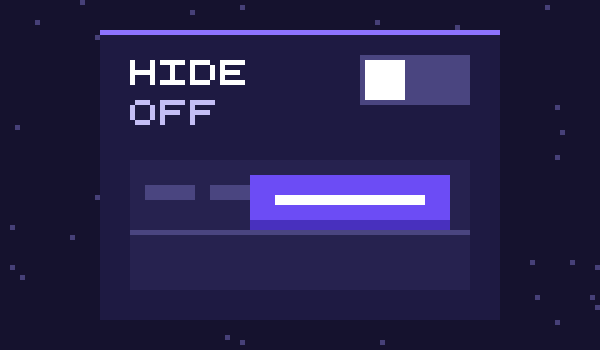
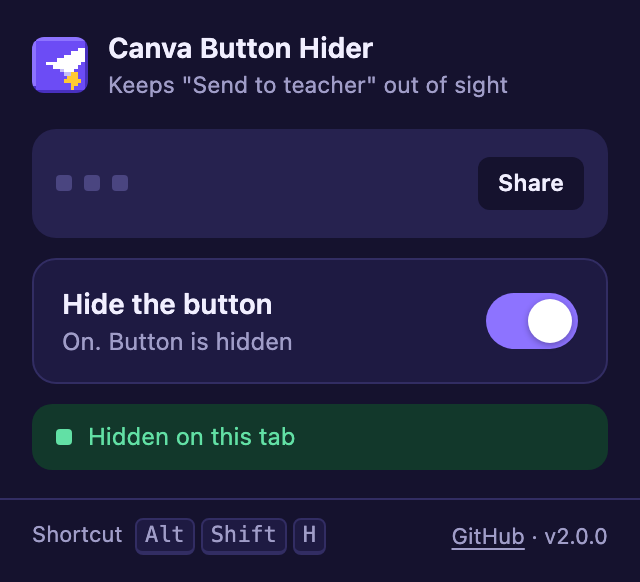

<p align="center">
  
</p>

<h1 align="center">Canva Button Hider</h1>

<p align="center">
  <strong>One click to hide the “Send to teacher” button on Canva Education designs.</strong><br />
  No more accidental submissions while you’re still working.
</p>

<p align="center">
  
  
  
  
</p>

---

## Why

Canva for Education puts a big **Send to teacher** button in the editor toolbar. It sits right next to Share, and one stray click can hand in unfinished work. This extension removes it from view, and brings it back the moment you want it.

## How it looks

<p align="center">
  
</p>

Click the toolbar icon, flip the switch, done. The change applies instantly to every open Canva tab, with no reload.

<p align="center">
  
</p>

## Features

- **Instant toggle** from a clean popup, with a live preview of what changes.
- **Works on already-open tabs.** No refresh needed.
- **Remembers your choice** and syncs it across your Chrome profile.
- **Keyboard shortcut:** `Alt` + `Shift` + `H` toggles it from anywhere.
- **Status at a glance:** the popup tells you whether the button is hidden on the current tab, and the toolbar icon shows an `OFF` badge when paused.
- **Light and dark mode**, and respects reduced-motion settings.
- **Private by design.** It asks only for `storage`, runs only on `canva.com/design/*`, makes no network requests and collects nothing.

## Install

The extension isn’t on the Chrome Web Store yet, so load it unpacked:

1. Download or clone this repo.
2. Open `chrome://extensions` and switch on **Developer mode**.
3. Click **Load unpacked** and choose the [`extension/`](extension) folder.
4. Pin the pixel plane icon to your toolbar.

Works in Chrome 102+ and other Chromium browsers (Edge, Brave, Arc).

## Usage

| Action | How |
| --- | --- |
| Hide / show the button | Click the icon, then the switch |
| Toggle without opening the popup | `Alt` + `Shift` + `H` (change it at `chrome://extensions/shortcuts`) |
| Check the current state | Look for the `OFF` badge, or open the popup |

## How it works

A small content script runs on `https://www.canva.com/design/*`. It finds buttons whose text is exactly “Send to teacher”, tags them with a data attribute, and a single CSS rule hides tagged buttons while the extension is on. Because Canva re-renders constantly, a `MutationObserver` re-scans (at most once per frame) to catch new copies. A tiny service worker keeps the badge and keyboard shortcut in sync with the saved setting.

```
extension/
├── manifest.json     Manifest V3, permissions, shortcut
├── background.js     Badge + keyboard shortcut
├── content.js        Finds and hides the button
├── popup.html/css/js The toggle UI
└── icons/            Pixel-art icons
```

## Development

```bash
# Build a store-ready zip into dist/
./scripts/package.sh

# Regenerate the pixel-art icons and README GIFs (needs Pillow)
python3 -m venv .venv && .venv/bin/pip install pillow
.venv/bin/python scripts/make_art.py
```

If Canva changes the button’s wording, update `TARGET_BUTTON_TEXT` in [`extension/content.js`](extension/content.js).

## Privacy

Nothing leaves your browser. The only data stored is one boolean (`enabled`) in Chrome’s sync storage.

## License

[MIT](LICENSE) © Aiman Amri. Not affiliated with or endorsed by Canva.
